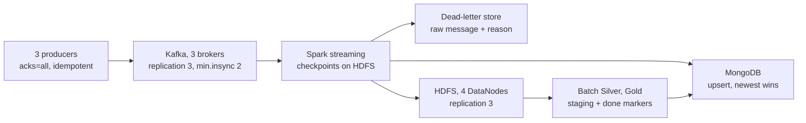

# Fault tolerance report

As of 2026-11-13. Every number below comes from a run on one machine (Docker, 16 CPU threads,
16 GB for Docker) with a known input, so each result is a count, not an impression. How the runs
work: [fault-injection.md](fault-injection.md) (data faults) and
[bigdata-experiments.md](bigdata-experiments.md) (load, failures, memory, reruns, schemas).

## Summary

The pipeline kept running through every failure we injected, and every check we have finished
counted zero lost and zero duplicated rows. The streaming run with two consumer kills, a broker
outage and a DataNode outage read all 606,080 messages back; its row-by-row reconciliation is
still to run.

- **Survives:** a consumer `kill -9` (twice), one Kafka broker down, one HDFS DataNode down,
  producer retries (1% of messages sent twice), a month rebuild that crashes (the rerun restores
  all 33,085,632 rows, no duplicates), malformed and legacy messages (now kept in a dead-letter
  store with the reason), a rebuild overwriting good data (Delta Lake keeps the old version).
- **Breaks:** a 1 GB Spark driver runs out of memory on a month (2 GB is enough); a crash while
  moving files leaves readers a quarter of a month until the rerun; the Delta quality gate let a
  bad rebuild through because its threshold was too loose (fixed since: a per-flag check now
  catches it).
- **Fixed on the way:** 8 defects the tests exposed (table below), among them the streaming Silver
  reading every Kafka record 5 times and a dedup tie-break that compared offsets as text.

## System under test

| Layer | What protects it | Tested by |
|---|---|---|
| Producers | `acks=all`, idempotent producer, a reading counts as sent only after Kafka confirms it | retries, broker outage |
| Kafka | 3 brokers, every partition on all 3, writes need 2 in-sync copies, 7 days kept | broker outage, demo (two brokers down) |
| Spark streaming | per-query checkpoints on HDFS, queries restart on their own, file sinks commit through the checkpoint, Silver batches published atomically | consumer `kill -9` |
| HDFS | 3 copies of every block on 4 DataNodes | DataNode outage |
| Batch Silver/Gold | staging folder, then move; a done marker per month | crashes at failpoints |
| Delta Lake (new) | one commit per overwrite, versions, `RESTORE` | bad rebuild, killed overwrite |

All services share one disk and one CPU, so absolute speeds are this machine's; the comparisons
between settings are the result.

## Method

- **Known input.** Streaming tests replay real January 2025 readings into Kafka with
  `src/chaos/replay.py`; every message Kafka acknowledged is listed in a manifest with its
  partition and offset. Batch tests start from the same month (33M rows).
- **Reconciliation.** `src/chaos/reconcile_stream.py` matches the manifest against the archive (by
  key), the streaming Silver (by Kafka offset) and the dead-letter store: each message is stored,
  quarantined with a reason, rejected with a reason, or lost.
- **Failures on cue.** Containers are killed (`docker kill` = `kill -9`) or stopped on a timeline;
  batch jobs crash at named failpoints (`CHAOS_CRASH_AT`, `src/common/failpoint.py`) exactly where
  a crash hurts most.
- **Control runs.** Each data-fault run is compared with the same month built without faults.

## Results

### Bad data (veracity)

18 kinds of bad data, about 0.6% of 33M rows, labelled row by row; the Silver rules then built the
month. Per fault: share of injected rows caught.

| Result | Faults |
|---|---|
| Caught (95–100%) | sentinel codes, impossible values, spikes (98%), misspelled parameter, misspelled unit, future timestamps, (0, 0) coordinates (repaired), missing sensor id, shifted columns, duplicates |
| Partly | swapped lat/lon 41% (swaps that stay possible pass), stuck sensor 83%, unit ×1000 88% |
| Missed (rule proposed, not built) | decimal comma `12,5`, local time sent as UTC, two different values for one sensor and time, unit ÷1000, calibration drift |

1,909 of 32,852,170 clean rows (0.006%) changed status against the control run. Details and the
proposed rules R15–R20: [fault-injection.md](fault-injection.md).

### Failures during streaming

606,080 messages at 3,000 msg/s (600,000 readings, 1% sent twice as producer retries), while:

| Time | Event |
|---|---|
| +45 s | consumer `kill -9` |
| +60 s | consumer restarted |
| +90 s | broker `kafka2` stopped |
| +120 s | DataNode `datanode2` stopped |
| +150 s | consumer `kill -9` again, restarted 10 s later |
| +180 s | `kafka2` back |

- The producer had **0 failed sends** of 606,080, through the broker outage.
- The archive and Silver queries **read all 606,080 messages** and ended 0 offsets behind.
- Silver's slowest micro-batch took 37 s (normal: about 11 s), while the restarted consumer caught up.
- **Pending:** the per-message count of lost and duplicated rows. The first reconciliation crashed
  on an empty dead-letter store (a bug since fixed); it needs one rerun.

In a 20,215-message test with 1% retries, reconciliation found every message: 0 lost, every retry
copy deduplicated with one row kept per key.

### Schema changes in the stream

100,000 messages, 2% each of seven variants, without a contract:

| Variant | Archive | Dead-letter store | Silver |
|---|---|---|---|
| current format (v2) | kept | - | stored |
| additive v3 (new optional field) | kept | - | stored (was rejected as "legacy" before the fix) |
| legacy v1 format | kept | - | quarantined: legacy_message |
| value field renamed | dropped | no_numeric_value | stored as invalid (value missing) |
| value sent as text | dropped | no_numeric_value | stored |
| keys missing | dropped | no_station_id | quarantined: no_sensor_id |
| JSON cut off | dropped | malformed_json | quarantined: malformed_message |
| oversized (2 MB) | never sent: Kafka's 1 MB limit, 96 producer errors | - | - |

0 keys stored twice in the archive or in Silver. With the contract (JSON Schemas in a Confluent
Schema Registry, BACKWARD compatibility, checked at the producer), 10,100 messages that break it
were sent to a dead-letter topic instead of the main topic; the registry accepted v3 as a new
version and refused the renamed schema. The per-variant reconciliation of that run is pending.

### Memory pressure

The full-month Silver build (33M rows), and R14 (a window over each sensor's month), at different
driver memory. Spill = data moved out of memory to make room.

| Job | Memory | Result | Time | Spilled (memory / disk) | GC share |
|---|---|---|---|---|---|
| Silver build | 1 GB | **failed**: OutOfMemoryError, 9 failed tasks | 38 s | 2.7 / 0.2 GB | 10.3% |
| Silver build | 2 GB | finished | 133 s | 35.2 / 2.8 GB | 5.2% |
| Silver build | 4 GB | finished | 145 s | 33.6 / 2.6 GB | 4.1% |
| Silver build | 8 GB | finished | 138 s | 30.4 / 2.3 GB | 3.2% |
| R14 flags | 2 GB, 500k rows per task (default) | finished | 174 s | 31.1 / 2.6 GB | 6.4% |
| R14 flags | 2 GB, 5M rows per task | **failed**: OutOfMemoryError | 19 s | - | - |

2 GB is the floor; above it, time stays at about 140 s because the job is bound by CPU and disk,
not memory. R14's `--rows-per-task` knob is what keeps it inside 2 GB: tasks 10 times larger run
out of memory. The streaming part (a 1 GB consumer after a 1M-message backlog) is pending.

### Reruns and crashes

| Step | What a reader sees in January 2025 |
|---|---|
| Month built | 4 files, 33,085,632 rows |
| Rebuild crashes while moving files (`silver.mid_move`) | **1 file, 8,522,408 rows (26%)** |
| Same run rerun | 4 files, 33,085,632 rows, all keys distinct |
| Rebuild crashes before its done marker, then rerun | 33,085,632 rows, all keys distinct |
| Delta: month loaded (v0) | 33,085,632 rows, 1.48% invalid |
| Delta: bad rebuild overwrites it (v1, the faulty chaos month) | 33,036,041 rows, 1.61% invalid |
| Delta: quality gate | **passed** (invalid +0.13%, rows −0.15%, limits 0.5% / 1%) |
| Delta: an overwrite killed after 45 s | still v1: the killed write left no partial version |

Reruns are safe: nothing is lost or stored twice. Between a crash and its rerun, plain Parquet
shows readers a broken month, because deleting the old files and moving the new ones in are
separate steps; Delta Lake commits a whole overwrite or nothing. The gate failed its job: most
injected faults end in quarantine, not as invalid rows, so the invalid share barely moved. The
gate now also compares the count of each quality flag between versions (a rise of 20% and at
least 100 rows fails it); in the batch demo below that check caught a faulty month.

### Throughput

300,000 messages at 2,000 msg/s: the consumer never fell behind (0 offsets behind at the end of
every micro-batch).

| Query | Rows per second while working | Batch time, median / worst |
|---|---|---|
| Archive | 41,000 | 1.2 s / 4.0 s |
| Dead-letter store | 58,000 | 0.7 s / 1.4 s |
| Silver | 4,000 | 10.9 s / 11.8 s |

Silver is the bottleneck, about 10 times slower than the archive: each batch applies the full rule
set and checks its keys against every batch committed before. The higher rates and the backlog
catch-up test are pending.

## Weaknesses found and fixed

| Problem | Cause | Fix |
|---|---|---|
| Silver read every Kafka record 5 times | each Spark action in the per-batch function re-read the batch from Kafka | the batch is persisted once: 101,075 reads -> 20,215 for 20,215 messages |
| A retry copy could replace the original | dedup's "oldest first" compared Kafka offsets as text (`1000` < `999`) | offsets zero-padded |
| Archive dropped unusable messages without a trace | the parser filtered them out | dead-letter store: raw message + reason |
| Silver rejected the additive schema v3 | it accepted only version 2 | versions 2 and 3 accepted |
| Fault injection used 2–4 of 16 cores | a month is 2 large files | repartitioned to 64 tasks |
| Spark generated code over its 64 KB limit | long expressions repeated the same hash | each hash computed once |
| The same input computed three times | a DataFrame reused by three actions is rebuilt each time | persisted once |
| Readers see a broken month after a crash | delete and move are separate steps | measured; Delta Lake commits atomically |

## Live demo

Two scripts show each kind of fault happening and the pipeline handling it, live, with Enter
before each step. Both were run end to end on this machine.

### Streaming: `scripts/experiments/demo.sh` (about 6 GB of RAM)

It starts Kafka, HDFS, the consumer under test and Locust (http://localhost:8089). Locust
(`loadtest/locustfile.py`) simulates three kinds of users:

- `SensorFleet`: sensors sending batches of 100 readings to Kafka with `acks=all`.
- `DashboardViewer`: people opening the dashboard's live map and station pages on MongoDB.
- `BadDataSender`: a broken feed, one bad message per second of a random kind (step 2).

The terminal shows the consumer's lag per micro-batch and, per Silver batch, where the rows went:
kept by status, quarantined by reason, deduplicated, and the quality flags. A 20-second check
with 4 normal users: 66 requests, 0 failures, Kafka batches acknowledged in 26 ms (median), the
live-map query in 210 ms.

| Step | Fault | What the audience sees | What handles it |
|---|---|---|---|
| 1 | none: 20 users, spawn rate 5, Start | requests/s rise, 0 failures | |
| 2 | 60 s of bad data, 10 kinds | each Silver batch line, e.g. `quarantined {malformed_message, no_sensor_id, legacy_message}`, `flags {sentinel, above_max, value_missing, value_not_numeric, ts_out_of_range, unknown_parameter}`, duplicates removed | Silver rules and quarantine; the archive's dead-letter store |
| 3 | broker `kafka2` down | writes go on; a latency blip | replication 3, min.insync 2 |
| 4 | broker `kafka3` down too | Kafka **refuses** writes (`NotEnoughReplicas`): failures in Locust, nothing accepted unsafely | `acks=all` + min.insync 2 |
| 5 | both brokers back | failures stop | |
| 6 | `kill -9` the consumer, then restart it | lag grows, then drains | checkpoints on HDFS |
| 7 | DataNode `datanode2` down, then back | the consumer keeps writing | HDFS replication 3 |

What each bad-data kind should become (the script prints this before step 2):

| Kind | Archive (raw readings) | Streaming Silver |
|---|---|---|
| malformed JSON | dead-letter: malformed_json | quarantine: malformed_message |
| keys missing | dead-letter: no_station_id | quarantine: no_sensor_id |
| value field renamed | dead-letter: no_numeric_value | kept, invalid: value_missing |
| decimal comma `12,5` | dead-letter: no_numeric_value | kept, invalid: value_not_numeric |
| legacy format | kept | quarantine: legacy_message |
| sentinel -999 | kept (raw) | kept, invalid: sentinel |
| impossible value | kept (raw) | kept, invalid: above_max |
| timestamp two years ahead | dead-letter: future_event_time | kept, invalid: ts_out_of_range |
| parameter `pm2.5` | kept (raw) | kept, invalid: unknown_parameter |
| same message twice | deduplicated | deduplicated |

The streaming Silver catches decimal commas (`value_not_numeric`); the batch Silver does not (the
bad_number gap in the data-fault results). Keep `DashboardViewer` users low when the dashboard
reads the free MongoDB Atlas tier: it limits operations per second, and the real dashboard shares
that limit.

### Batch: `scripts/experiments/demo_batch.sh` (Spark only, about 3 GB)

| Step | Fault | Measured on this machine | What handles it |
|---|---|---|---|
| 1 | a Silver rebuild of the Southeast Asia month crashes right after deleting the old files (`silver.after_delete`) | a reader finds the month **empty** (0 of 930,617 rows); the rerun of the same run id restores all 930,617, every key distinct | staging + done markers make the rerun safe |
| 2 | R14 on the full month in 2 GB with tasks of 5M rows | `OutOfMemoryError` after 16 s; with the default 500k rows per task it finishes (174 s in the memory experiment) | `--rows-per-task` |
| 3 | a faulty rebuild overwrites the month in a Delta table | the invalid share rises only 0.13%, but the per-flag check finds jumps (coordinates invalid 0 -> 959, spike 13 -> 257, unknown parameter 0 -> 109) and fails; `RESTORE` brings back version 0 with all 930,617 rows | Delta Lake versions + quality gate |

## Open items

- Rerun the reconciliation of the failure run and the schema contract run (counts of lost and
  duplicated messages).
- Run the throughput steps above 2,000 msg/s and the backlog catch-up, with and without
  `maxOffsetsPerTrigger`, and the 1 GB streaming consumer.
- Rerun the full-month Delta step of the reprocessing experiment with the new per-flag gate.
- Build rules R15–R20 for the missed data faults.
